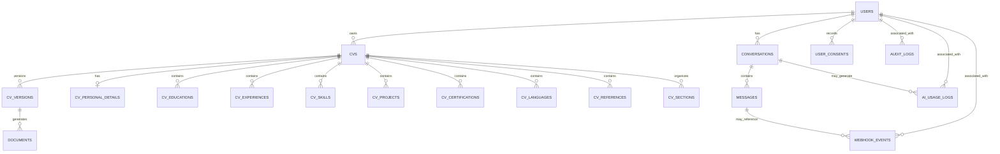

# CareerBotTz Database ERD and Persistence Design

**Document:** `docs/DATABASE_ERD.md`
**Project:** CareerBotTz
**Source baseline:** Version 1.0, 11 October 2026
**Status:** Draft for review — not approved
**Current phase:** P01 — Requirements and Architecture Approval
**Task:** P01-T04 — Finalize ERD and persistence constraints

## 1. Purpose

This document defines the proposed database entity inventory, relationships, ownership rules, persistence constraints, versioning requirements, and unresolved database decisions for CareerBotTz.

It is based on the following source documents:

1. `CareerBotTz_System_Design_and_Implementation_Roadmap_v1 (1).pdf`
2. `CareerBotTz_Complete_Implementation_Blueprint.pdf`
3. `CareerBotTz_Codespaces_Roadmap.pdf`

The database design must also remain consistent with:

- `docs/REQUIREMENTS.md`
- `docs/ARCHITECTURE.md`
- `docs/IMPLEMENTATION_PLAN.md`
- The approved conversation, AI, security, and operations contracts produced during P01.

This document is a proposed design for review. It is not an approved schema and does not authorize the creation or execution of database migrations.

## 2. Database baseline

The architectural baseline identifies **MySQL 8.4 LTS** as the authoritative persistent store.

Laravel is responsible for enforcing application business rules, authorization, input validation, workflow transitions, and persistence rules. Gemini and the Node.js/Baileys gateway must not become alternative authoritative stores for CV business data.

Redis and Laravel Horizon are identified in the architecture baseline for queues and queue monitoring. They do not replace MySQL as the authoritative persistent store.

The exact Laravel version, compatible database driver, migration strategy, and runtime configuration remain subject to verification.

## 3. Design principles

The proposed database design must support the following requirements.

### 3.1 Identity and ownership

- Resolve a WhatsApp identity consistently using the approved phone-number normalization rules.
- Prevent duplicate user identities.
- Associate conversations and CV records with the appropriate user.
- Enforce ownership on every operation involving CVs, versions, and generated documents.
- Prevent a user from accessing another user's CV or document.

### 3.2 Incremental persistence

- Preserve accepted CV answers as the user progresses.
- Allow incomplete drafts to be resumed after interruption.
- Avoid overwriting an unrelated CV or draft.
- Preserve data integrity when messages arrive rapidly or are retried.

### 3.3 Version integrity

- Separate working CV content from confirmed versions.
- Require explicit confirmation before creating a confirmed snapshot.
- Keep confirmed snapshots immutable.
- Ensure generated documents refer to the intended CV and version.
- Prevent later edits from silently changing historical confirmed content.

### 3.4 Idempotency and concurrency

- Prevent duplicate account creation for the same normalized identity.
- Record and deduplicate inbound provider events.
- Protect state and CV changes against concurrent processing.
- Avoid creating duplicate CVs or confirmed versions because of retries.
- Define transaction boundaries and concurrency controls before implementation.

### 3.5 Security, audit, and retention

- Restrict access to sensitive personal information and generated documents.
- Avoid storing unnecessary sensitive data.
- Record relevant security-sensitive and administrative actions.
- Define consent, retention, deletion, backup, and recovery behavior before production.

## 4. Proposed 19-table inventory

The Complete Implementation Blueprint identifies the following proposed 19-table inventory. These names are preserved from `docs/REQUIREMENTS.md`.

| No. | Proposed table | Intended responsibility |
|---:|---|---|
| 1 | `users` | User identity and account information |
| 2 | `conversations` | Conversation context, state, and language preference |
| 3 | `messages` | Inbound and outbound message records |
| 4 | `cvs` | User-owned CV records and working CV identity |
| 5 | `cv_personal_details` | Personal details associated with a CV |
| 6 | `cv_educations` | Education entries associated with a CV |
| 7 | `cv_experiences` | Employment and work-experience entries |
| 8 | `cv_skills` | Skills associated with a CV |
| 9 | `cv_projects` | Project entries associated with a CV |
| 10 | `cv_certifications` | Certification entries associated with a CV |
| 11 | `cv_languages` | Language-proficiency entries associated with a CV |
| 12 | `cv_references` | Professional-reference entries associated with a CV |
| 13 | `cv_sections` | CV section information; exact purpose and relationship to specialized tables require review |
| 14 | `cv_versions` | CV version records and confirmed snapshot lifecycle |
| 15 | `documents` | Generated document metadata and generation/delivery status |
| 16 | `webhook_events` | Provider-event records and inbound-event deduplication |
| 17 | `ai_usage_logs` | AI operation, usage, and failure records |
| 18 | `user_consents` | User consent records and related evidence |
| 19 | `audit_logs` | Relevant security-sensitive and administrative activity |

**Important:** This inventory is a source-defined proposal, not a final approved schema. P01-T04 must determine whether all 19 tables are required, whether any responsibilities overlap, and whether additional or alternative structures are justified by the approved requirements.

No table should be removed, added, or materially redesigned without recording the rationale and reviewing the affected requirements and source documents.

## 5. Proposed entity relationship diagram

The diagram below shows the proposed logical relationships that need review. It is not a statement that foreign keys, columns, cardinalities, or deletion policies have already been approved.

### 5.1 Diagram interpretation

The relationships shown are proposed logical relationships to be validated during P01-T04.

In particular:

- `USERS` to `CVS` expresses the requirement that users own their CVs.
- `CONVERSATIONS` to `MESSAGES` expresses the proposed relationship between a conversation and its recorded messages.
- `CVS` to the specialized CV tables expresses the association of CV content with its parent CV.
- `CVS` to `CV_VERSIONS` expresses the requirement for CV history and confirmed versions.
- `CV_VERSIONS` to `DOCUMENTS` expresses the intended relationship between a document and the version used to generate it.
- `WEBHOOK_EVENTS` supports inbound-event processing and deduplication.
- `AI_USAGE_LOGS`, `USER_CONSENTS`, and `AUDIT_LOGS` support the proposed operational, consent, and audit requirements.

The precise cardinality of personal details, the ownership and nullable relationships of logs, and the relationship between generic sections and specialized CV tables must be resolved before the ERD is approved.

The diagram intentionally does not define exact SQL column types, indexes, cascade actions, or all foreign keys. Those details require review and must be recorded in the final schema specification.

## 6. Proposed table-level design requirements

This section records the responsibilities and constraints to consider for each proposed table. Exact columns, data types, indexes, and foreign keys remain pending review.

### 6.1 `users`

**Purpose:** Represent a CareerBotTz user and the identity used to resolve WhatsApp interactions.

Required design considerations:

- Store the normalized WhatsApp identity used for account resolution.
- Prevent duplicate normalized identities with an appropriate database uniqueness constraint.
- Define account status and relevant timestamps.
- Avoid unnecessary collection of personal data.
- Define how account deletion and retention affect related records.

The exact phone-number normalization format and any separate raw/display value must be decided and documented before implementation.

### 6.2 `conversations`

**Purpose:** Represent a user's conversation context and persisted workflow state.

Required design considerations:

- Associate a conversation with the appropriate user.
- Persist the supported conversation-language preference or its approved source of truth.
- Support the approved conversation-state machine.
- Define how an active conversation is identified.
- Protect state updates against concurrent message processing.
- Define the relationship between conversations, messages, and the selected CV or draft where required.

The final state names, transition rules, and active-conversation policy belong in `docs/AI_CONVERSATION.md`.

### 6.3 `messages`

**Purpose:** Record relevant inbound and outbound conversation messages.

Required design considerations:

- Associate a message with the appropriate conversation.
- Distinguish inbound and outbound direction where needed.
- Define provider message identifiers and deduplication relationships.
- Define the treatment of delivery status, processing status, timestamps, and failed operations.
- Avoid unnecessary retention of sensitive message content.
- Define redaction and retention rules.

Whether full message bodies are retained, minimized, or redacted requires an explicit privacy decision.

### 6.4 `cvs`

**Purpose:** Represent a user's named CV and its working lifecycle.

Required design considerations:

- Associate each CV with its owning user.
- Support multiple named CVs per user.
- Distinguish a CV record from its working draft and confirmed versions.
- Define naming, selection, rename, and deletion behavior.
- Define how active editing and concurrent updates are represented.
- Prevent cross-user access through application authorization and suitable database relationships.

The final relationship between the working CV record and its version records must be settled before migrations are created.

### 6.5 `cv_personal_details`

**Purpose:** Store personal details associated with a CV.

Required design considerations:

- Associate the record with the correct CV.
- Define whether one CV can have only one current personal-details record.
- Validate and minimize personal information.
- Define which fields are required, optional, or excluded.
- Define how updates interact with working drafts and confirmed snapshots.

The one-to-one relationship shown in the proposed ERD is a design proposal that must be confirmed.

### 6.6 `cv_educations`

**Purpose:** Store education entries for a CV.

Required design considerations:

- Associate each entry with its parent CV.
- Support multiple education entries.
- Define ordering and editing behavior.
- Define permitted incomplete or optional fields.
- Preserve accepted facts without fabricating qualifications or dates.

### 6.7 `cv_experiences`

**Purpose:** Store employment and work-experience entries for a CV.

Required design considerations:

- Associate each entry with its parent CV.
- Support multiple entries and ordering.
- Allow a user with no employment history to proceed without fabricated experience.
- Define how current employment and incomplete dates are represented.
- Define optional fields and validation rules.

### 6.8 `cv_skills`

**Purpose:** Store skills associated with a CV.

Required design considerations:

- Associate each entry with its parent CV.
- Define whether skills are individual records, grouped records, or represented differently.
- Define ordering and duplicate-handling behavior.
- Ensure AI-generated wording remains supported by user-provided information.

### 6.9 `cv_projects`

**Purpose:** Store project entries associated with a CV.

Required design considerations:

- Associate each entry with its parent CV.
- Support optional project sections.
- Define project names, descriptions, dates, and other fields only after requirements review.
- Prevent unsupported AI-generated project claims.

### 6.10 `cv_certifications`

**Purpose:** Store certifications associated with a CV.

Required design considerations:

- Associate each entry with its parent CV.
- Support optional certification entries.
- Define how issuer, title, dates, and other relevant fields are validated.
- Prevent invented certifications or credentials.

### 6.11 `cv_languages`

**Purpose:** Store language-proficiency information associated with a CV.

Required design considerations:

- Associate each entry with its parent CV.
- Define language and proficiency representation.
- Define permitted values or validation rules after review.
- Do not confuse the user's conversation-language preference with the languages listed in a CV.

### 6.12 `cv_references`

**Purpose:** Store professional-reference entries associated with a CV.

Required design considerations:

- Associate each entry with its parent CV.
- Define optionality and the permitted reference fields.
- Minimize exposure of third-party personal information.
- Define consent and retention considerations where applicable.
- Prevent fabricated references.

### 6.13 `cv_sections`

**Purpose:** The source inventory names this table but does not, by itself, fully define its relationship to the specialized CV tables.

P01-T04 must determine:

- Whether it represents configurable section metadata, section ordering, optional-section selection, generic section content, or another approved responsibility.
- Whether its responsibilities overlap with the specialized CV tables.
- Whether it is required in addition to those tables.
- How section ordering and omission are represented.
- How section changes are preserved across working drafts and confirmed versions.

No generic JSON payload, duplicate section-content model, or additional structure should be assumed without an explicit design decision.

### 6.14 `cv_versions`

**Purpose:** Support CV history and the confirmed-snapshot lifecycle.

Required design considerations:

- Associate each version with its parent CV.
- Define how a version is numbered or identified.
- Distinguish working content from confirmed snapshots.
- Record confirmation state and relevant timestamps where required.
- Preserve the content of a confirmed snapshot against later edits.
- Ensure a document can be traced to the intended version.
- Define whether the snapshot stores a full content copy, normalized versioned data, or another approved representation.

The exact snapshot strategy, immutability enforcement, and relationship to editable CV tables must be resolved before implementation.

### 6.15 `documents`

**Purpose:** Record generated documents and their lifecycle.

Required design considerations:

- Associate each document with the appropriate CV version.
- Define the relationship to the owning user and CV.
- Record generation status separately from delivery status.
- Define private storage references and retrieval authorization.
- Support safe redelivery of a successfully generated document.
- Define failure information, timestamps, and retention behavior.
- Avoid storing document contents in a publicly accessible location.

The exact storage provider, file metadata, status vocabulary, and retry mechanism remain pending review.

### 6.16 `webhook_events`

**Purpose:** Support tracking and deduplication of provider events.

Required design considerations:

- Identify the provider or event source as required.
- Define the stable provider event identifier or deduplication key.
- Prevent the same inbound event from repeating its business operation.
- Record relevant processing state and timestamps.
- Define failure and retry behavior.
- Define retention and payload minimization.
- Avoid storing unnecessary sensitive payload data.

The final uniqueness scope for event identifiers must be defined using the selected gateway contract.

### 6.17 `ai_usage_logs`

**Purpose:** Support operational visibility into AI requests and usage.

Required design considerations:

- Record relevant AI operation outcomes and failures.
- Support usage and latency monitoring.
- Define which identifiers associate a record with a user, conversation, or operation.
- Minimize storage of raw personal data and CV content.
- Define redaction and retention behavior.
- Prevent logs from becoming an alternative authoritative source for CV data.

Exact token, cost, request, and response fields must be selected according to the approved AI contract and privacy requirements.

### 6.18 `user_consents`

**Purpose:** Record relevant consent decisions and their evidence.

Required design considerations:

- Define which consent or acknowledgement events must be recorded.
- Associate consent evidence with the appropriate user where applicable.
- Record the relevant purpose, status, and timestamp as approved.
- Define how changes or withdrawals are represented where applicable.
- Define retention and deletion behavior.

The consent model must follow the reviewed privacy requirements; this document does not establish legal conclusions or final consent wording.

### 6.19 `audit_logs`

**Purpose:** Record relevant security-sensitive and administrative activity.

Required design considerations:

- Record the actor and action where applicable.
- Identify the affected resource or operation without unnecessary exposure of sensitive content.
- Record relevant timestamps and outcomes.
- Support investigation of authorized administrative actions.
- Protect audit records from unauthorized alteration or access.
- Define retention and deletion behavior.

The exact event catalogue, actor model, and integrity requirements remain pending the security and operations review.

## 7. Relationship and integrity requirements

### 7.1 Referential integrity

The final schema should define appropriate primary keys and foreign keys for relationships confirmed in the approved ERD.

Foreign-key behavior must be selected deliberately. It must not be assumed that every relationship should cascade on deletion.

The final design must document:

- Required and optional relationships.
- Foreign-key columns and referenced keys.
- Uniqueness constraints.
- Nullability.
- Appropriate deletion and update behavior.
- Relevant indexes.
- Data ownership and authorization implications.

### 7.2 User ownership

Every CV must have a clearly defined owner.

Operations involving CVs, versions, and documents must verify ownership through the approved Laravel authorization path.

Database relationships alone do not replace application authorization. Tests must verify that one user cannot read, edit, rename, delete, or download another user's CV or document.

### 7.3 Identity uniqueness

The normalized WhatsApp identity must resolve consistently to the intended user.

The final schema must define a suitable unique constraint and account-resolution strategy. Normalization must be performed according to an approved rule before the identity is relied on for uniqueness.

### 7.4 Inbound-event uniqueness

The event-deduplication design must identify which provider event is considered the same event and the scope in which its identifier is unique.

The final database design must prevent concurrent processing from creating duplicate business effects for the same event.

### 7.5 Transaction and concurrency boundaries

The design must identify which changes require atomic persistence.

Examples requiring review include:

- Resolving or creating a user identity.
- Applying an accepted answer to a working CV.
- Advancing a conversation state.
- Recording a confirmed version.
- Creating a document-generation record.
- Recording event-processing outcomes.

Locking, optimistic revision checks, transactions, and idempotency mechanisms must be selected according to the approved workflow and integration contracts.

### 7.6 Confirmed snapshot integrity

A confirmed snapshot must not change because a working draft is edited later.

The final schema and application design must define how snapshot contents are preserved, how a new version is created, and how generated documents refer to a specific version.

The implementation must not rely solely on a user-interface convention to protect confirmed data.

## 8. Indexing and query design

The final ERD must identify indexes justified by the approved query and integrity requirements.

Candidate areas for review include:

- Unique normalized user identity.
- Foreign keys and ownership lookups.
- Conversation lookup by user and approved active-state criteria.
- Message lookup by conversation and chronological ordering.
- Provider event deduplication keys.
- CV lookup by owner and relevant lifecycle state.
- Version lookup by CV and version ordering.
- Document lookup by version and lifecycle status.
- Operational log lookup by relevant identifiers and timestamps.

These are indexing candidates, not a finalized index list. Exact index definitions, column order, uniqueness, and query patterns must be reviewed before migrations are written.

## 9. Deletion, retention, and privacy

The source requirements explicitly identify deletion and retention as unresolved decisions.

The final design must define:

- What deleting a CV means for its working content.
- Whether confirmed versions are retained, anonymized, or deleted under the approved policy.
- What happens to generated PDFs when a CV or version is deleted.
- How associated messages, webhook events, AI usage records, consent records, and audit records are treated.
- Whether retention obligations require certain records to remain.
- How backup copies and restored data follow the approved policy.
- How deletion is verified and audited.

The design must distinguish application-level deletion from permanent erasure and backup-retention behavior.

No cascade deletion, hard-delete policy, soft-delete policy, retention period, or anonymization rule is approved by this draft.

Applicable Tanzanian personal-data protection requirements must be reviewed before production.

## 10. Migration planning and implementation constraints

Database migrations are downstream of P01-T04 approval.

Before migration creation, the project must have:

1. A reviewed and approved ERD.
2. Approved entity and relationship definitions.
3. Approved primary and foreign keys.
4. Approved uniqueness and integrity constraints.
5. Approved versioning and confirmed-snapshot strategy.
6. Approved deletion and retention semantics.
7. An agreed migration dependency order.
8. A verified development database configuration.
9. A review of the existing database to determine whether it contains data.
10. Tests or documented verification procedures for the approved schema.

The 19-table inventory must not be converted mechanically into migrations before its responsibilities and relationships have been reconciled.

No database migration, reset, or destructive database operation is authorized by this document.

## 11. Database verification requirements

The final schema and its implementation must be verified against the approved requirements.

| Verification area | Expected result |
|---|---|
| User identity | Equivalent normalized WhatsApp identities resolve to one account |
| Multiple CVs | A user can create separate named CVs without overwriting another CV |
| Draft persistence | Accepted draft data remains available after interruption |
| Ownership | Cross-user CV and document access is denied |
| CV history | Historical versions can be listed without mutating them |
| Confirmation | Only explicit confirmation creates a confirmed snapshot |
| Snapshot integrity | Later edits do not change a confirmed snapshot |
| Event deduplication | Repeated provider events do not repeat business operations |
| Concurrency | Rapid or concurrent messages cannot corrupt persisted state |
| Document association | A generated PDF references the intended CV version |
| Generation and delivery | Generation status and delivery status remain distinct |
| Deletion | Approved deletion and retention behavior is followed |
| Audit and privacy | Required events are traceable without unnecessary sensitive-data exposure |

These are planned verification expectations, not evidence of passing tests. Actual results and evidence must be recorded during implementation and testing.

## 12. Open database decisions

The following decisions must be resolved or explicitly recorded as blockers before the ERD is approved.

1. Whether the proposed 19-table inventory is complete and appropriate.
2. The final column definitions, primary keys, foreign keys, and relationships.
3. The exact responsibility of `cv_sections` alongside specialized CV tables.
4. The representation of working CV content and draft lifecycle.
5. The confirmed-snapshot representation and immutability strategy.
6. The relationship between CVs, versions, documents, and document retries.
7. The source of truth for conversation-language preference and workflow state.
8. Message-content retention and sensitive-data minimization.
9. The normalized WhatsApp identity format and uniqueness rule.
10. The provider event identifier and deduplication scope.
11. Transaction, locking, and concurrency-control strategy.
12. Index definitions and expected query patterns.
13. Foreign-key deletion behavior and retention policy.
14. Consent evidence and its lifecycle.
15. Audit event coverage and retention.
16. Database migration ordering and compatibility verification.

Each decision must have an owner, rationale, status, and affected requirements or tasks recorded in the project documentation.

## 13. Traceability

This database design primarily supports the following requirements from `docs/REQUIREMENTS.md`:

- `REQ-001` — First valid inbound interaction and account creation.
- `REQ-002` — Normalized WhatsApp identity.
- `REQ-005` — Multiple named CVs.
- `REQ-006` — Incrementally saved drafts.
- `REQ-007` — Explicit draft selection and resume.
- `REQ-008` — Persistence of approved CV sections.
- `REQ-010` — Editing, renaming, deletion, ownership, and retention.
- `REQ-011` — CV history.
- `REQ-012` — Review, confirmation, and confirmed snapshots.
- `REQ-016` — Inbound-event deduplication.
- `REQ-020` — Immutable confirmed versions.
- `REQ-022` — Concurrent conversation integrity.
- `REQ-024` — Security and protection of sensitive records.
- `REQ-027` — Inspection before project changes.
- `REQ-028` — ERD and state-transition approval before dependent implementation.
- `REQ-030` — Maintenance of the seven required design documents.

Related acceptance scenarios include `ACC-01`, `ACC-05`, `ACC-06`, `ACC-07`, `ACC-09`, `ACC-11`, `ACC-12`, and `ACC-15`.

The precise task mapping and acceptance evidence must remain consistent with `docs/IMPLEMENTATION_PLAN.md` and the source roadmap. This document does not declare any of those scenarios passed.

## 14. Approval record

**Document status:** Draft for review — not approved.

| Review item | Status |
|---|---|
| Proposed 19-table inventory | Pending review |
| Entity relationships and cardinalities | Pending review |
| Primary and foreign keys | Pending review |
| Ownership and authorization implications | Pending review |
| Identity and event uniqueness | Pending review |
| Draft and confirmed-snapshot model | Pending review |
| Indexes and concurrency strategy | Pending review |
| Deletion and retention semantics | Open |
| Migration order | Pending review |
| Source-to-requirement traceability | Pending review |
| User approval | Not granted |
| P01 phase gate | Not approved |
| P02 authorization | Not granted |

**Implementation rule:** This document is a database design draft. It does not authorize migration creation, migration execution, database resets, or progression to P02. Dependent implementation may begin only after the relevant database decisions and the explicit P01 phase gate have been approved.